# UKK TKJ Paket 2 – Migrasi Cloud Terenkripsi, Hardening VM & Disaster Recovery

Dokumentasi praktik Uji Kompetensi Keahlian (UKK) Teknik Komputer dan Jaringan, Tahun Ajaran 2026/2027.
Dikerjakan oleh **Nevan Kaindra Rusdi** – SMK Bina Informatika.

**Tools:** Proxmox VE · MikroTik CHR · Ubuntu Server 22.04 · MariaDB · Nginx · PHP 8.1-FPM · Moodle 4.4 · OpenSSL · UFW · Bash · Cron

## Daftar Isi
1. [Topologi Jaringan](#1-topologi-jaringan)
2. [Konfigurasi VM di Proxmox](#2-konfigurasi-vm-di-proxmox)
3. [Router MikroTik CHR & DHCP](#3-router-mikrotik-chr--dhcp)
4. [Database Server (VM DB-05)](#4-database-server-vm-db-05)
5. [LMS Moodle + HTTPS (VM Web-05)](#5-lms-moodle--https-vm-web-05)
6. [Port Forwarding (MikroTik CHR)](#6-port-forwarding-mikrotik-chr)
7. [Monitoring dengan Bash & Cron](#7-monitoring-dengan-bash--cron)
8. [Backup & Restore (Disaster Recovery)](#8-backup--restore-disaster-recovery)
9. [Troubleshooting](#9-troubleshooting)

---

## 1. Topologi Jaringan

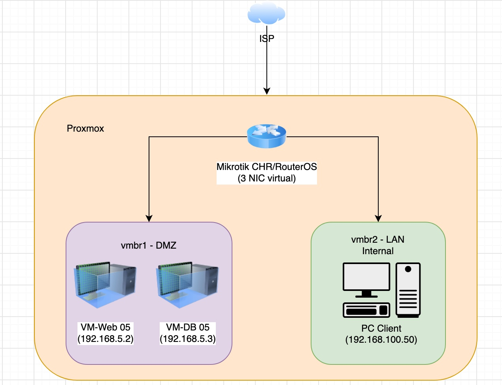

| Perangkat | Bridge | IP Address |
|---|---|---|
| MikroTik CHR – WAN | vmbr0 | 192.168.1.201/24 |
| MikroTik CHR – DMZ | vmbr1 | 192.168.5.1/29 |
| MikroTik CHR – LAN | vmbr2 | 192.168.100.1/24 |
| VM Web-05 | vmbr1 (DMZ) | 192.168.5.2 |
| VM DB-05 | vmbr1 (DMZ) | 192.168.5.3 |
| PC Client | vmbr2 (LAN) | 192.168.100.50 |

## 2. Konfigurasi VM di Proxmox

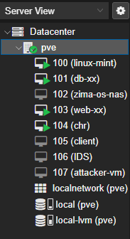
*Gambar 1. Daftar VM pada Proxmox VE*

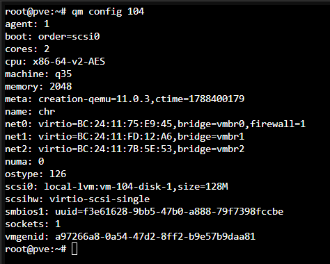
*Gambar 2. MikroTik CHR dengan 3 interface ke vmbr0, vmbr1, dan vmbr2*

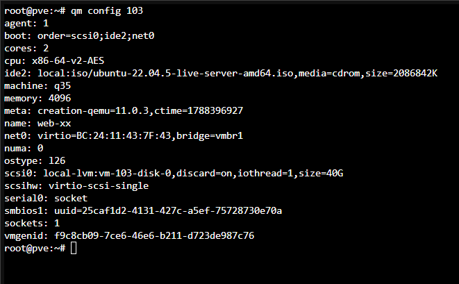
*Gambar 3. VM Web-05 terhubung ke vmbr1*

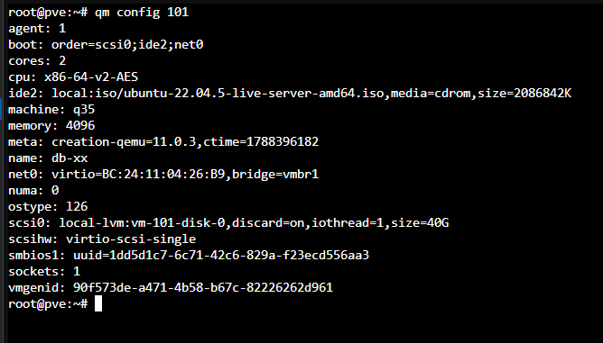
*Gambar 4. VM DB-05 terhubung ke vmbr1*

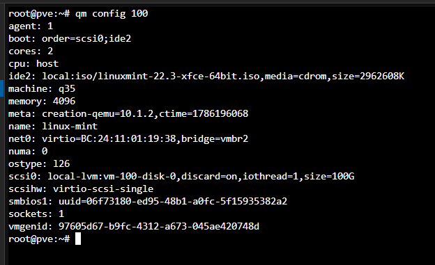
*Gambar 5. PC Client terhubung ke vmbr2*

## 3. Router MikroTik CHR & DHCP

DHCP Server di jaringan LAN hanya punya **satu alamat di pool (192.168.100.50)** dan memakai **static lease berdasarkan MAC address** PC Client. Dengan cara ini, perangkat asing (rogue device) tidak bisa mendapatkan IP.

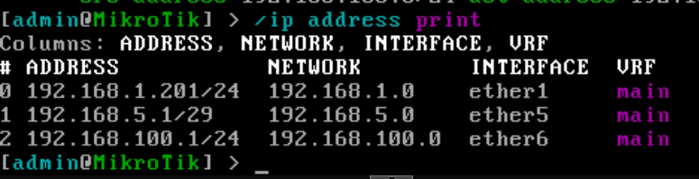
*Gambar 6. IP address pada MikroTik CHR*

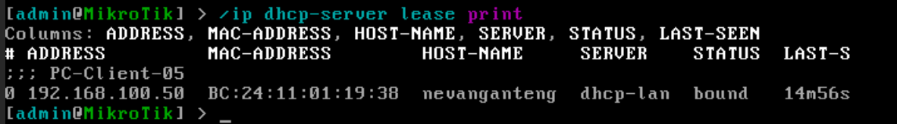
*Gambar 7. DHCP static lease aktif*

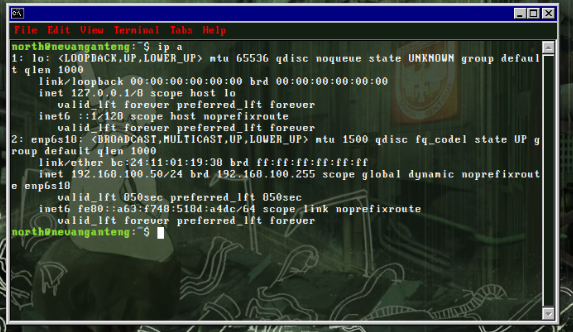
*Gambar 8. PC Client mendapat IP 192.168.100.50 lewat DHCP*

## 4. Database Server (VM DB-05)

```bash
sudo apt install mariadb-server -y
sudo nano /etc/mysql/mariadb.conf.d/50-server.cnf   # bind-address = 0.0.0.0
sudo systemctl restart mariadb
sudo mysql -u root
```

```sql
CREATE DATABASE moodle DEFAULT CHARACTER SET utf8mb4 COLLATE utf8mb4_unicode_ci;
GRANT ALL PRIVILEGES ON moodle.* TO 'moodleuser'@'192.168.5.2' IDENTIFIED BY '<password>';
FLUSH PRIVILEGES;
```

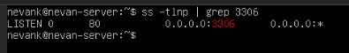
*Gambar 9. MariaDB listen di 0.0.0.0:3306*

**Hardening dengan UFW:** default *deny incoming*. Port 3306/tcp hanya dibuka untuk IP VM Web (192.168.5.2).

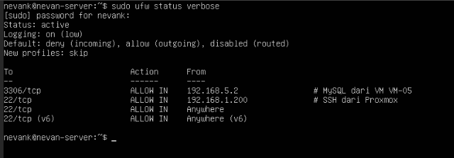
*Gambar 10. Status UFW di VM DB-05*

## 5. LMS Moodle + HTTPS (VM Web-05)

```bash
sudo apt install nginx php8.1-fpm php8.1-mysql php8.1-curl php8.1-gd \
  php8.1-intl php8.1-mbstring php8.1-xml php8.1-zip php8.1-soap php8.1-xmlrpc -y

cd /var/www && sudo wget https://download.moodle.org/download.php/direct/stable404/moodle-4.4.tgz
sudo tar -xzf moodle-4.4.tgz && sudo chown -R www-data:www-data /var/www/moodle
sudo mkdir /var/moodledata && sudo chown www-data:www-data /var/moodledata

# Sertifikat SSL self-signed (berlaku 365 hari)
sudo mkdir -p /etc/nginx/ssl
sudo openssl req -x509 -nodes -days 365 -newkey rsa:2048 \
  -keyout /etc/nginx/ssl/moodle.key -out /etc/nginx/ssl/moodle.crt \
  -subj "/C=ID/ST=Banten/L=Tangerang Selatan/O=SMK/OU=TKJ/CN=192.168.5.2"
```

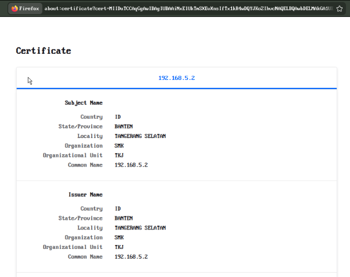
*Gambar 11. Detail sertifikat SSL self-signed*

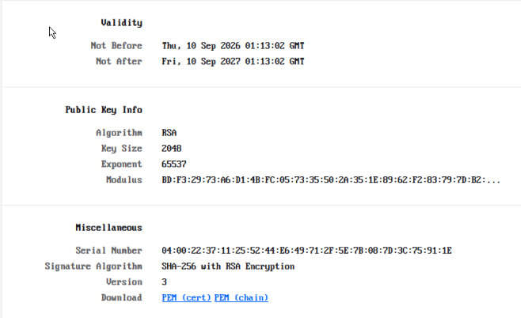
*Gambar 12. Masa berlaku sertifikat dan kunci RSA 2048-bit*

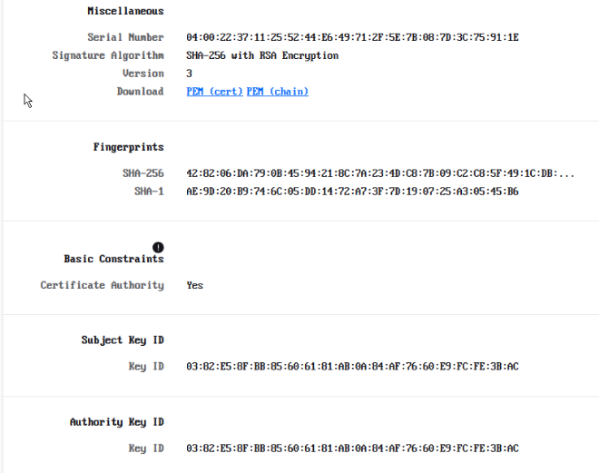
*Gambar 13. Fingerprint sertifikat (SHA-256)*

Virtual host Nginx dengan redirect HTTP → HTTPS:

```nginx
server {
    listen 80;
    server_name 192.168.5.2;
    return 301 https://$server_name$request_uri;
}

server {
    listen 443 ssl;
    server_name 192.168.5.2;
    ssl_certificate     /etc/nginx/ssl/moodle.crt;
    ssl_certificate_key /etc/nginx/ssl/moodle.key;
    root /var/www/moodle;
    index index.php index.html;

    location / {
        try_files $uri $uri/ /index.php?$query_string;
    }

    location ~ [^/]\.php(/|$) {
        fastcgi_split_path_info ^(.+\.php)(/.+)$;
        fastcgi_pass unix:/var/run/php/php8.1-fpm.sock;
        include fastcgi_params;
        fastcgi_param SCRIPT_FILENAME $document_root$fastcgi_script_name;
        fastcgi_param PATH_INFO $fastcgi_path_info;
    }
}
```

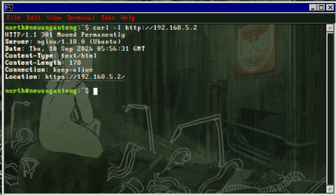
*Gambar 14. Redirect HTTP ke HTTPS (301 Moved Permanently)*

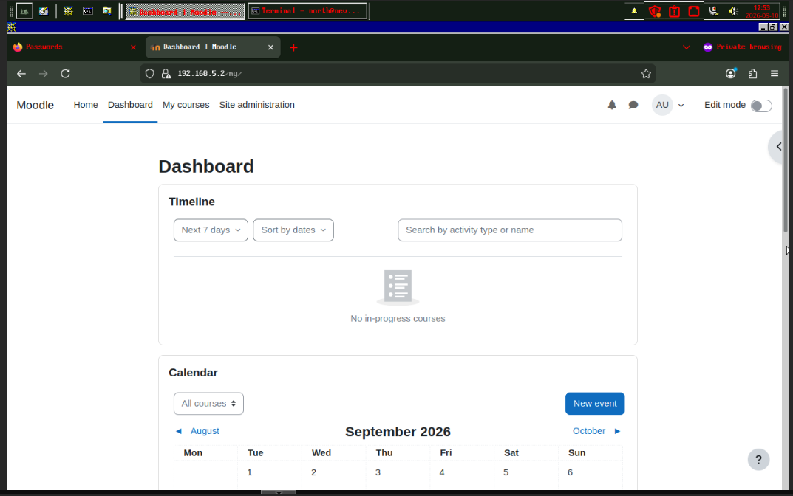
*Gambar 15. Dashboard Moodle diakses lewat HTTPS*

## 6. Port Forwarding (MikroTik CHR)

```
/ip firewall nat add chain=dstnat action=dst-nat dst-address=192.168.1.201 protocol=tcp dst-port=9090 \
    to-addresses=192.168.5.2 to-ports=443 comment="Forward WAN:9090 -> Web-05:443"

/ip firewall nat add chain=srcnat action=masquerade src-address=192.168.100.0/24 \
    dst-address=192.168.5.2 protocol=tcp dst-port=443 comment="Hairpin NAT LAN -> Web via WAN IP"
```

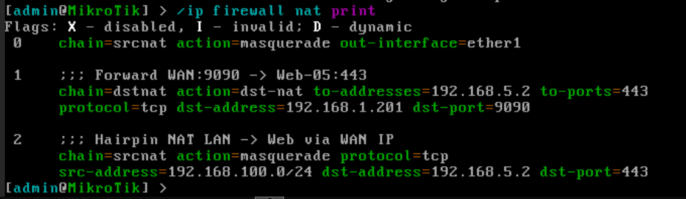
*Gambar 16. Rule dst-nat 9090 → 443 dan hairpin NAT*

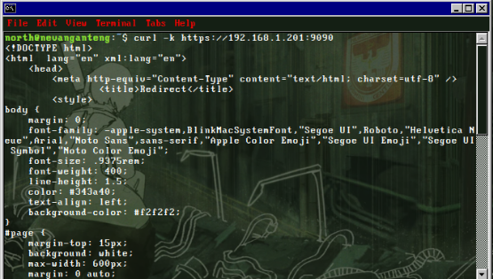
*Gambar 17. Moodle bisa diakses lewat 192.168.1.201:9090*

## 7. Monitoring dengan Bash & Cron

Script `monitor_ram.sh` mencatat penggunaan RAM beserta timestamp ke `/var/log/ram_usage.log`. Script ini dijalankan otomatis tiap 5 menit lewat crontab.

```
*/5 * * * * /usr/local/bin/monitor_ram.sh
```

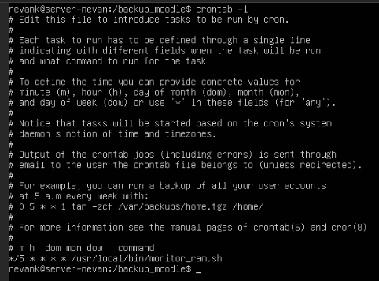
*Gambar 18. Crontab untuk monitor_ram.sh*

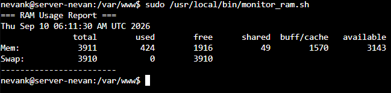
*Gambar 19. Isi /var/log/ram_usage.log*

## 8. Backup & Restore (Disaster Recovery)

Script `backup_data.sh` mem-backup folder `/var/www/moodle` dan database `moodle` (lewat `mysqldump` dari VM DB 192.168.5.3), lalu menggabungkan keduanya jadi satu arsip `.tar.gz`. Nama file memakai timestamp `DATE=$(date +%Y%m%d_%H%M%S)`, jadi backup lama tidak tertimpa.

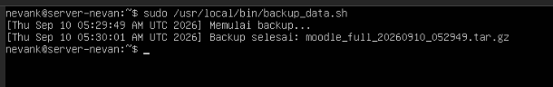
*Gambar 20. Script backup berhasil dijalankan*

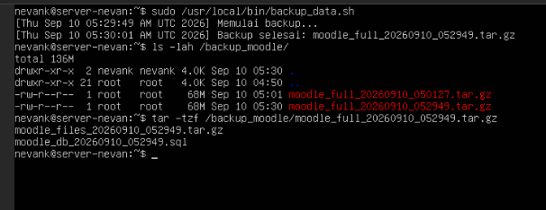
*Gambar 21. File backup dengan nama dinamis*

**Simulasi bencana:** folder `/var/www/moodle` sengaja dihapus.

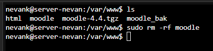
*Gambar 22. Folder Moodle dihapus*

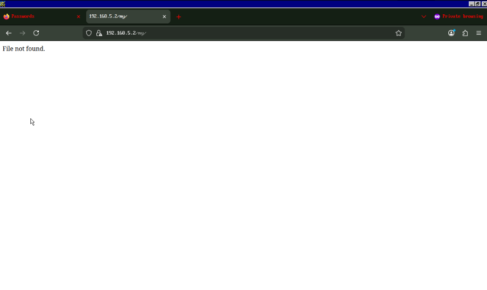
*Gambar 23. Moodle tidak bisa diakses*

**Restore:**

```bash
cd /backup_moodle
sudo tar -xzf moodle_full_20260910_052949.tar.gz
sudo tar -xzf moodle_files_20260910_052949.tar.gz -C /
sudo chown -R www-data:www-data /var/www/moodle
```

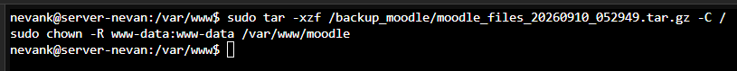
*Gambar 24. Proses restore*

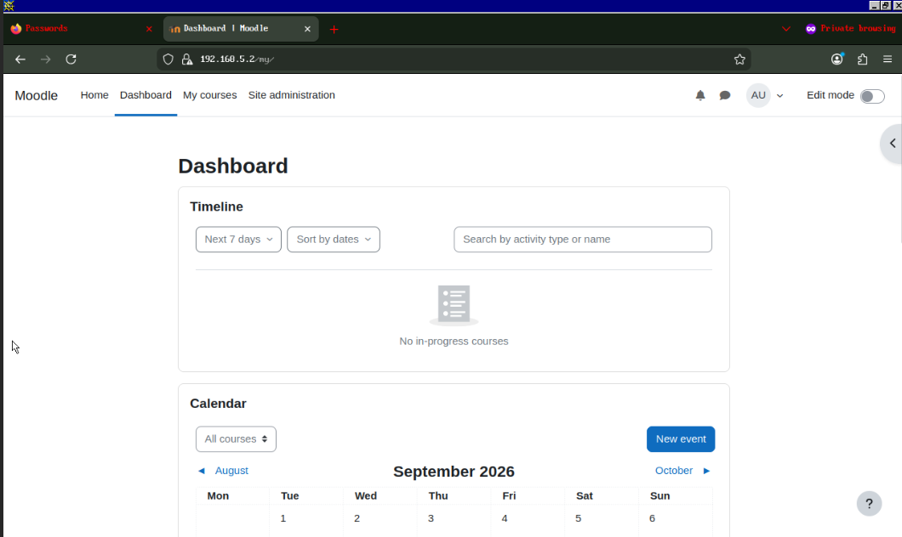
*Gambar 25. Moodle kembali normal setelah restore*

## 9. Troubleshooting

| Masalah | Penyebab | Solusi |
|---|---|---|
| Client tidak dapat IP DHCP, gateway unreachable | Port LAN router salah terhubung ke vmbr1 (DMZ) | Cocokkan MAC address di router dan Proxmox, pindahkan port LAN ke vmbr2 |
| Nama file backup tanpa tanggal & *Permission denied* | Typo variabel (`TE` seharusnya `DATE`), folder backup hanya bisa diakses root | Perbaiki script, atur hak akses folder, jalankan dengan sudo |
| Moodle gagal konek ke database (*Access denied*) | Database masih ada di server Web (127.0.0.1), bukan di server DB | Pindahkan database ke 192.168.5.3, atur ulang izin user, ubah host di `config.php` |
